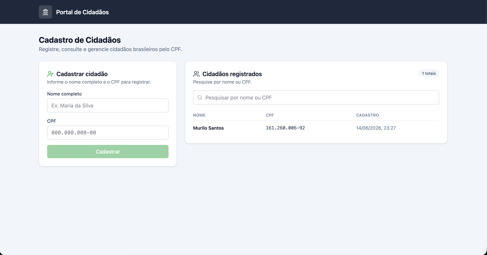
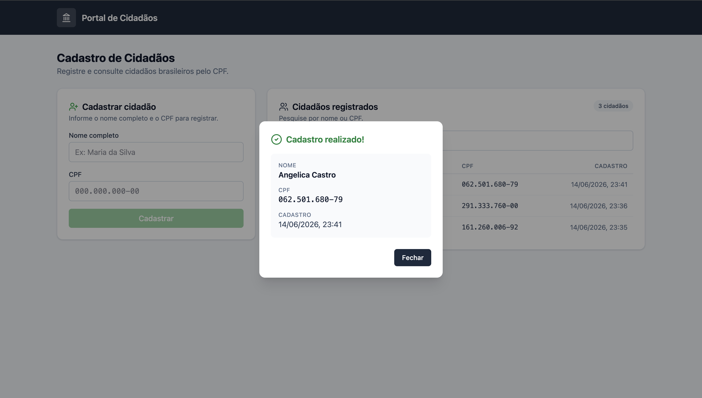
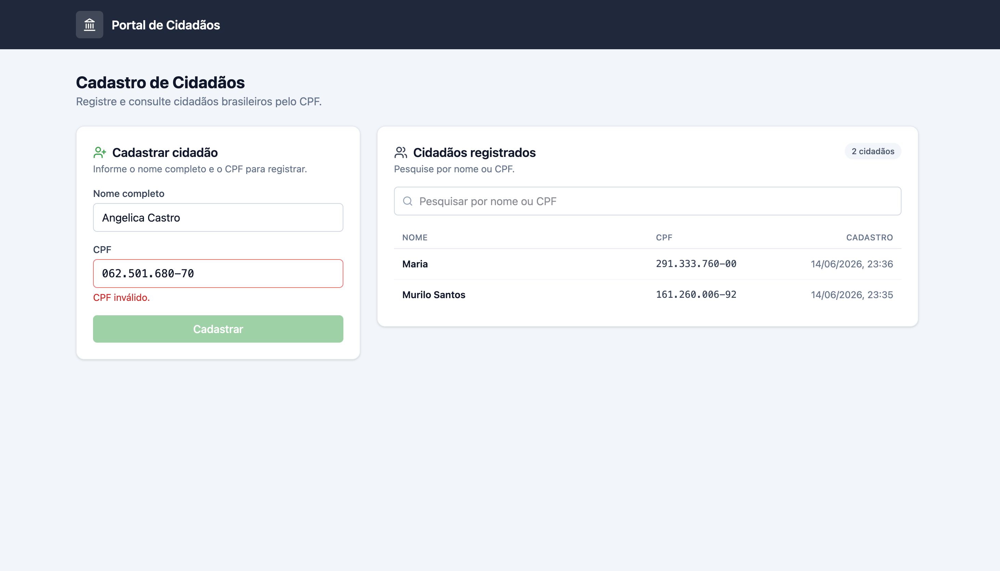
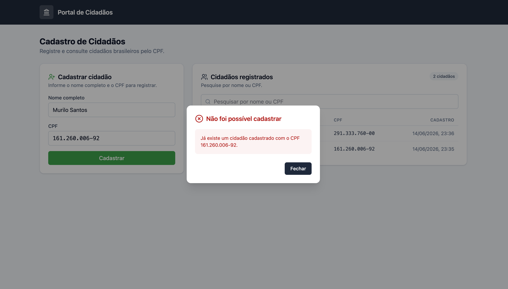
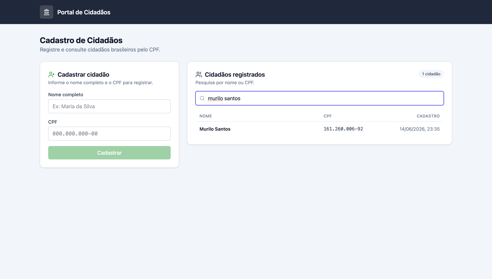
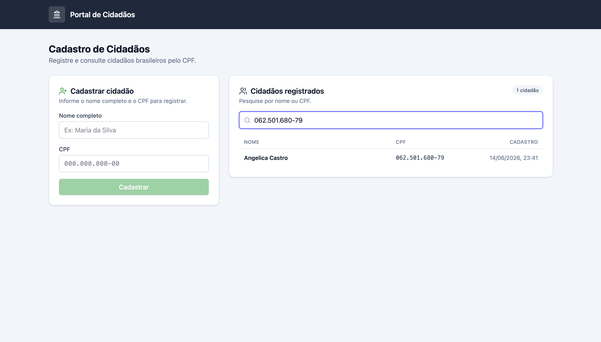
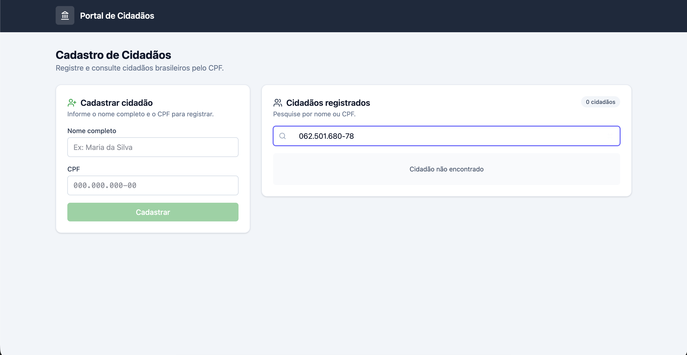

# Cadastro de Cidadãos

## Visão geral

Aplicação para cadastro e pesquisa de cidadãos brasileiros, desenvolvida como desafio técnico. Permite cadastrar um cidadão informando nome completo e CPF (validado automaticamente pelo algoritmo de dígitos verificadores), pesquisar registros por nome ou CPF.

O backend é uma API REST organizada em camadas (DDD simplificado), com o CPF modelado como Value Object, tratamento de erros centralizado e testes automatizados unitários. O frontend é uma SPA em React, organizada por feature e com a mesma separação de responsabilidades em camadas (componentes → contexto → service → API).

**Stack**

| Camada | Tecnologia |
|---|---|
| Backend | PHP 8.3, Symfony 7.4, Doctrine ORM |
| Banco | PostgreSQL 16 |
| Frontend | React 19, TypeScript, Vite, Context API, Tailwind CSS |
| Testes (back) | PHPUnit |
| Testes (front) | Vitest + Testing Library |
| Gerenciadores | Composer (PHP), npm (JS) |
| Infra | Docker Compose, Makefile |

## Interface



Tela única dividida em dois painéis:

- **Cadastrar cidadão** (à esquerda): formulário com nome completo e CPF. O CPF recebe máscara `000.000.000-00` enquanto é digitado e é validado em tempo real. O botão **Cadastrar** só habilita quando nome e CPF são válidos. O resultado (sucesso ou erro) é exibido em um modal com os dados cadastrados.
- **Cidadãos registrados** (à direita): campo de busca por nome ou CPF (parcial, com debounce) e a lista de registros com nome, CPF formatado e data de cadastro. O contador de **totais** fica no topo do painel.

### Telas por requisito

**Cadastro com mensagem de sucesso**: após validar, exibe um modal com nome, CPF e data do cadastro.



**CPF validado automaticamente**: CPF com dígitos verificadores inválidos é sinalizado em tempo real (campo em vermelho, aviso "CPF inválido." e botão **Cadastrar** bloqueado).



**CPF já cadastrado**: ao tentar cadastrar um CPF que já existe, a API responde 409 e a interface mostra a mensagem de erro.



**Pesquisa por nome**: busca parcial e case-insensitive pelo nome do cidadão.



**Pesquisa por CPF**: busca pelo número do CPF (com ou sem máscara).



**Cidadão não encontrado**: quando a busca não retorna resultados, exibe a mensagem "Cidadão não encontrado".



## Requisitos do desafio

Mapa entre o que o desafio pede e onde está resolvido no projeto.

**Obrigatórios**

| Requisito | Onde está |
|---|---|
| Formulário com nome e CPF obrigatórios | `CitizenForm` (front) + validação no `CreateCitizenService` (back) |
| CPF validado automaticamente | Value Object `Cpf` (dígitos verificadores, módulo 11) |
| Exibir os dados cadastrados com mensagem de sucesso | `CitizenResultModal`, aberto pelo `CitizenForm` |
| Pesquisar por nome ou CPF | `GET /api/v1/citizens?search=` → `searchByNameOrCpf` |
| "Cidadão não encontrado" quando não existe | `CitizenList` quando a busca retorna lista vazia |
| Backend em Node.js, PHP ou C# | PHP 8.3 com Symfony |
| Paradigma orientado a objetos | Entidade, Value Object, Services e Repositories |
| Interface amigável | SPA React com Tailwind CSS |
| README com instruções de execução | Este arquivo |

## Como executar

### Com Docker (recomendado)

Requisitos: Docker e Docker Compose instalados. Na raiz do projeto:

```bash
make start
```

O comando sobe os containers (banco, backend e frontend), roda a suíte de testes e aplica as migrations. Depois:

- **Interface (frontend): http://localhost:5173**
- API: http://localhost:8000/api/v1/citizens
- Swagger: http://localhost:8000/api/doc

### Comandos disponíveis

O `Makefile` na raiz concentra os comandos do projeto. `make` sem argumentos lista todos.

```bash
make start             # sobe a aplicação, roda os testes e aplica as migrations
make up                # sobe a aplicação
make test              # roda todas as suítes (backend + frontend)
make test-back         # só os testes do backend (PHPUnit)
make test-front        # só os testes do frontend (Vitest)
make migrate           # aplica as migrations
make logs              # logs do backend
make db-reset          # recria o banco (apaga os dados)
make down              # remove os containers (dados ficam)
make clean             # remove containers e volumes
make install-local     # instala o node_modules do frontend no host (só p/ o editor)
```

Para comandos avulsos: `docker compose exec backend <comando>` (PHP, Composer, console do Symfony); `make psql` abre o cliente do Postgres.

Sem `make`, use os comandos `docker compose` equivalentes:

```bash
docker compose up -d --build                                                              # make up
docker compose exec backend php bin/console doctrine:migrations:migrate --no-interaction  # make migrate
docker compose exec backend php bin/phpunit                                               # make test-back
docker compose exec frontend npm run test                                                 # make test-front
docker compose down                                                                       # make down
```

> **Suporte ao editor (opcional):** como o `node_modules` fica no container, o editor não acha os tipos. Rode `make install-local` para instalar as dependências no host e resolver isso.

### Sem Docker

**Backend.** Requisitos: PHP 8.3 ou superior (extensões `pdo_pgsql` e `intl`), Composer e um PostgreSQL acessível.

```bash
cd backend

cp .env.example .env

composer install

php bin/console doctrine:database:create --if-not-exists
php bin/console doctrine:migrations:migrate --no-interaction

php -S localhost:8000 -t public public/index.php
```

Sem Docker, rode os testes do backend:

```bash
php bin/phpunit
```

**Frontend.** Requisitos: Node.js 22 ou superior e npm.

```bash
cd frontend
npm install
cp .env.example .env     # define VITE_API_URL (URL base da API)
npm run dev              # interface em http://localhost:5173
```

O frontend lê a URL base da API da variável `VITE_API_URL`, definida no `.env` (use o `.env.example` como referência). O valor padrão é `http://localhost:8000`; se a variável não existir, a aplicação usa esse mesmo endereço como fallback.

Outros scripts:

```bash
npm run test         # roda os testes (Vitest)
npm run build        # build de produção (type-check + bundle)
```

## Arquitetura

### Backend

Separação em camadas, com as dependências apontando sempre para dentro: o domínio não conhece Doctrine, a aplicação não conhece HTTP. A ligação entre contratos e implementações é feita pela injeção de dependência do Symfony.

```
backend/
├── config/                  configuração do Symfony e dos bundles
├── migrations/              migrations do banco (Doctrine)
├── src/
│   ├── Domain/
│   │   ├── Entity/          Citizen (entidade persistida)
│   │   └── ValueObject/     Cpf (validação e normalização do CPF)
│   ├── Application/
│   │   ├── Exception/       AppException (mensagem + status HTTP)
│   │   └── Features/
│   │       └── Citizen/
│   │           ├── Dto/         dados de entrada e saída da feature
│   │           ├── Exception/   CpfAlreadyExistsException (409)
│   │           ├── Repository/  contrato do repositório de cidadãos
│   │           └── Service/     casos de uso (create, list)
│   ├── Infrastructure/
│   │   └── Repository/      implementações Doctrine dos contratos
│   └── Presentation/
│       ├── Controller/      endpoints REST
│       └── EventListener/   conversão de exceções em respostas JSON
└── tests/
    └── Domain/, Application/, Infrastructure/   testes unitários
```

### Frontend

Organização por feature com a mesma ideia de camadas do backend: o componente só apresenta e dispara eventos, o contexto orquestra o estado e o service isola os endpoints, consumindo a API via `fetch` e convertendo erros em `ApiError` tipado. A regra de domínio do CPF (validação e máscara) vive em uma função pura, fácil de testar.

```
frontend/
├── src/
│   ├── features/
│   │   └── citizens/
│   │       ├── components/   CitizenForm, CitizenList (UI da feature)
│   │       ├── context/      CitizensProvider + useCitizens (estado + casos de uso)
│   │       ├── services/     citizenService (chamadas REST via fetch)
│   │       └── types/        contratos (Citizen, payloads)
│   ├── shared/
│   │   ├── api/              ApiError (erro tipado com status HTTP)
│   │   ├── components/       AppHeader (UI genérica)
│   │   └── utils/            cpf (validação/máscara), date (formatação)
│   ├── App.tsx               layout e composição da página
│   └── main.tsx              bootstrap (React)
└── *.spec.ts(x)             testes (Vitest + Testing Library), ao lado do código
```

O fluxo de dados é unidirecional: **componente → contexto → service → API**. Nenhum componente fala diretamente com o HTTP, e o contexto é a única fonte de verdade do estado dos cidadãos.

## Infraestrutura (Docker)

A stack roda em containers orquestrados pelo Docker Compose. São três arquivos.

### `docker-compose.yml`

Define e conecta os três serviços:

| Serviço | Imagem / origem | Porta | Descrição |
|---|---|---|---|
| `database` | `postgres:16-alpine` | 5432 | Banco de dados, com volume persistente (`database_data`) e healthcheck (`pg_isready`) |
| `backend` | build de `./backend` | 8000 | API Symfony; recebe a `DATABASE_URL` apontando para o serviço `database` |
| `frontend` | build de `./frontend` | 5173 | SPA React servida pelo Vite |

Configurações:

- O `backend` declara `depends_on` o `database` com `condition: service_healthy`, iniciando apenas após o Postgres aceitar conexões.
- O volume nomeado `database_data` persiste os dados do banco entre execuções; é removido com `make clean`.
- Bind mounts (`./backend:/app`, `./frontend:/app`) montam o código no container, refletindo alterações sem rebuild.
- O volume anônimo `- /app/node_modules` no frontend preserva as dependências instaladas na imagem, evitando que o bind mount as sobrescreva.

### `backend/Dockerfile`

Imagem a partir de `php:8.3-cli`:

- Instala as extensões PHP utilizadas pelo projeto: `pdo_pgsql` e `intl`.
- Copia o Composer da imagem oficial `composer:2`.
- Executa a aplicação com o servidor embutido do PHP, servindo `public/index.php` na porta 8000.

### `frontend/Dockerfile`

Imagem a partir de `node:22-alpine`:

- Copia `package*.json` e executa `npm install` antes do restante do código, aproveitando o cache de camadas para as dependências.
- Executa o Vite (`--host 0.0.0.0`) na porta 5173.

## API

| Método | Rota | Descrição | Sucesso |
|---|---|---|---|
| POST | `/api/v1/citizens` | Cadastra um cidadão | 201 |
| GET | `/api/v1/citizens` | Lista/pesquisa cidadãos | 200 |

Todos os endpoints estão documentados e podem ser testados pelo Swagger em http://localhost:8000/api/doc (botões Try it out e Execute).

### Listagem e busca

Parâmetro opcional no `GET /api/v1/citizens`:

- `search`: nome (parcial, case-insensitive) ou CPF, com ou sem máscara; ausente retorna todos os cidadãos

### Corpo de POST

```json
{
  "name": "Maria da Silva",
  "cpf": "529.982.247-25"
}
```

O CPF pode vir com ou sem máscara; a API normaliza antes de validar e armazenar.

### Erros

Todas as falhas respondem no mesmo formato:

```json
{ "error": { "message": "CPF inválido: 123.", "status": 400 } }
```

| Situação | Status |
|---|---|
| CPF inválido ou nome vazio | 400 |
| CPF já cadastrado | 409 |

O 409 é garantido em duas frentes. O service checa a existência antes de cadastrar. Para requisições concorrentes, o índice único do banco é a fonte de verdade: a violação de unicidade é traduzida para o mesmo 409 em vez de virar um erro genérico.

## Testes

### Backend

A suíte é toda unitária (`tests/Domain`, `tests/Application`, `tests/Infrastructure`): Value Object de CPF, entidade, services com repositórios mockados e o repositório com o `EntityManager` mockado. Não dependem de banco.

`make test-back` roda os testes do backend. Total: 16 testes unitários. (`make test` roda backend + frontend de uma vez, e a suíte também roda automaticamente no `make start`.)

### O que cada teste verifica

**`CpfTest`**: o Value Object de CPF (`tests/Domain/ValueObject`)
- `testAcceptsValidCpfAndNormalizesIt`: um CPF válido (com ou sem máscara) é aceito e guardado como 11 dígitos limpos.
- `testRejectsInvalidCpf`: CPFs ruins (tamanho errado, dígito verificador inválido, sequência repetida como `111.111.111-11`) são recusados, e o objeto nem chega a ser criado.

**`CitizenTest`**: a entidade Cidadão (`tests/Domain/Entity`)
- `testCreatesCitizenWithValidData`: ao criar um cidadão com dados válidos, ele expõe corretamente o nome e o CPF.
- `testNormalizesRedundantWhitespaceInName`: espaços redundantes no nome são normalizados (ex.: `  Maria   da  Silva  ` → `Maria da Silva`).
- `testRejectsBlankName`: nome em branco (só espaços) é recusado.
- `testRejectsNameLongerThanColumnLimit`: nome acima do limite da coluna (255) é recusado.

**`CreateCitizenServiceTest`**: caso de uso de cadastro (`tests/Application`, repositório mockado)
- `testCreatesCitizenWhenDataIsValid`: com nome e CPF válidos, o cidadão é cadastrado e salvo.
- `testRejectsBlankName`: nome em branco é recusado.
- `testRejectsDuplicatedCpf`: se o CPF já existe, o cadastro falha e nada é salvo no banco.

**`ListCitizensServiceTest`**: listagem e busca (`tests/Application`)
- `testReturnsCitizensFromRepository`: devolve a lista de cidadãos vinda do repositório.
- `testSearchesWithEmptyTermWhenNoneIsGiven`: sem termo de busca, lista todos (busca com string vazia).
- `testDelegatesSearchTermToRepository`: repassa o termo de busca ao repositório como recebido (sem alterar espaços).

**`CitizenRepositoryTest`**: o repositório Doctrine (`tests/Infrastructure`, `EntityManager` mockado)
- `testPersistsAndFlushesCitizen`: o `create` persiste a entidade e confirma a transação (`persist` + `flush`).
- `testTranslatesUniqueViolationIntoConflict`: a violação do índice único no `flush` é traduzida para `CpfAlreadyExistsException` (409).

### Frontend

Testes com **Vitest** e **Testing Library**, ao lado do código (`*.spec.ts`/`*.spec.tsx`). Rode com `make test-front` (via Docker) ou `cd frontend && npm run test`. Total: 13 testes.

**`cpf.spec.ts`**: a validação e máscara de CPF (função pura)
- `stripCpf`: remove máscara e qualquer caractere não numérico.
- `maskCpf`: aplica a máscara `000.000.000-00` conforme se digita e ignora dígitos além de 11.
- `isValidCpf`: aceita CPF válido (com e sem máscara) e rejeita dígito verificador errado, tamanho inválido e sequências repetidas.

**`CitizensProvider.spec.tsx`**: o estado de cidadãos (contexto, com o service mockado)
- "carrega a lista e calcula o total": ao listar, o total reflete a quantidade de cidadãos.
- "retorna o cidadão cadastrado e recarrega a lista": após cadastrar, o cidadão criado é devolvido e a lista é atualizada.
- "retorna a mensagem da API em caso de erro": quando a API recusa (ex.: CPF duplicado), a mensagem é devolvida ao formulário sem afetar o erro da listagem.

**`CitizenForm.spec.tsx`**: o formulário de cadastro (renderizado com Testing Library)
- "ignora letras e limita o CPF a 11 dígitos com máscara": digitar lixo resulta em um CPF mascarado e saneado.
- "mostra 'CPF inválido.' e desabilita o botão": com CPF inválido, o aviso aparece e o cadastro fica bloqueado.
- "exibe o modal de sucesso com os dados cadastrados": após cadastrar, o diálogo mostra os dados retornados pela API.

## Decisões de projeto

### Padrões aplicados

- **Arquitetura em camadas (DDD simplificado)**: Domain → Application → Infrastructure → Presentation, com as dependências sempre apontando para dentro. O domínio não conhece Doctrine; a aplicação não conhece HTTP.
- **Value Object (`Cpf`)**: imutável e validado no construtor, garantindo que um CPF inválido nunca exista como objeto.
- **Repository + Dependency Inversion**: a aplicação define o contrato (`CitizenRepositoryInterface`) e a infraestrutura o implementa com Doctrine, isolando a regra de negócio da persistência.
- **Service por caso de uso**: cada operação (create, list) é um service com um único `execute()`.
- **DTOs**: separam o contrato de entrada/saída da API do modelo de domínio.
- **Tratamento de erros centralizado**: um event listener traduz exceções da API para o JSON de erro padrão, mantendo os controllers sem try/catch.

### Aprofundamento

- **CPF como Value Object**: a validação (11 dígitos, dígitos verificadores via módulo 11, rejeição de sequências repetidas como `111.111.111-11`) fica no construtor de `Cpf`. CPF inválido lança exceção e o objeto não é criado. O resto do sistema trabalha com um CPF sempre válido e normalizado.
- **Tratamento de erros centralizado**: um event listener intercepta as exceções das rotas da API e responde no JSON de erro padrão. Services lançam `AppException` com mensagem e status HTTP; controllers não têm try/catch.
- **CPF duplicado à prova de concorrência**: além da checagem prévia no service, o índice único do banco protege contra cadastros simultâneos. O repositório captura a violação de unicidade e a traduz para o mesmo `CpfAlreadyExistsException` (409).

### Frontend

- **Organização por feature em camadas**: componentes de apresentação, contexto (Context API + hook `useCitizens`) como única fonte de verdade do estado e service isolando os endpoints (consumo via `fetch`). Trocar a API ou o estilo das telas não atravessa as camadas.
- **Validação de CPF em dois lados**: o front valida com a mesma regra do backend (`cpf.ts`) para dar feedback imediato (máscara ao digitar e botão desabilitado enquanto o CPF é inválido), mas o backend continua sendo a fonte de verdade (nunca se confia só no cliente).
- **Função pura para o domínio do CPF**: a validação/máscara fica fora do React, o que a torna trivialmente testável e reaproveitável.
- **Feedback por modais**: o cadastro abre um diálogo com os dados cadastrados (sucesso) ou a mensagem vinda da API (erro, ex.: CPF já cadastrado).
- **Funcionalidades além do pedido**: o desafio pede cadastro e busca; a interface também lista todos os registros com o total, espelhando os endpoints do backend. É um extra de gerência; o fluxo obrigatório (cadastrar, validar, exibir com mensagem de sucesso e pesquisar) permanece o foco.
